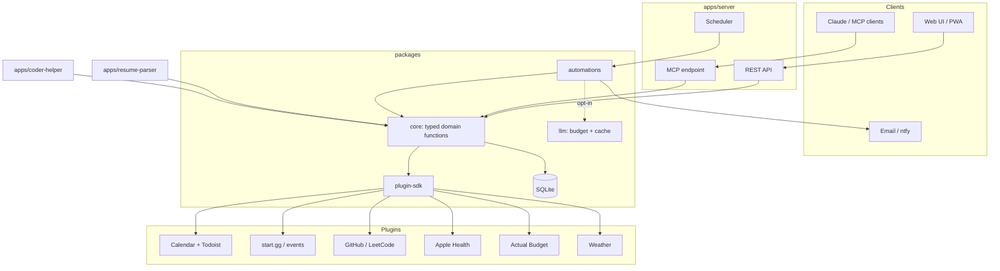

# Mars — Plan
 
A self-hosted, open-source, plugin-based personal hub (think Nextcloud for your life): calendar and tasks, events for hobbies, habits, finance, health, and automations. Everything is exposed over MCP so AI agents can use it.
 
Status: parked. Revisit when there's time. Default to a small, time-boxed build.
 
## Goals
 
- One place for the things I actually use, with plugins people can pick and choose from.
- Self-hosted first (laptop locally, then a small VPS or always-on box behind Tailscale).
- Learn MCP, plugin architecture, and self-hosting by building it. Have a real repo to show on a resume.
- Help me plan my week and find real-world hobby and social events so I don't fall through the week.
Non-goals (for now): multi-user, hosted SaaS, cloning Bevel/Hevy/MacroFactor, pixel-perfect UI.
 
## Time budget
 
- 3-4 hours a week, one slot, never on a night I could be out meeting people.
- If a feature takes more than a weekend, it waits.
- Stop and evaluate after 3 weeks of v0. If I use it daily, extend it. If not, polish the README and stop.
- The coder helper shares this budget. Don't build both in parallel.
## Feature scope
 
### Automations
- Dedicated page for crons and automations.
- Two job types per automation:
  - **No-token (deterministic):** e.g. morning weather email, alert if snow or heavy rain is forecast.
  - **LLM (opt-in):** per-automation model choice and a monthly budget cap.
- Delivery: email and push (self-hosted ntfy).
### Management
- Google Calendar + Todoist plugin.
- Week planner: tell it my plans in plain language, it shifts things around in minutes (LLM calls the same typed core functions the MCP server exposes).
- Resume parser (separate app, reads from the store).
- Event tracker (start.gg, Luma/Meetup, etc.) scored against my interests.
- Interests (fighting games, anime/manga, OPTCG, Pokémon, sci-fi, etc.).
- Finance view: use Actual Budget (open source, envelope budgeting) as the source via a plugin; add investments via CSV import and my goals on top. Don't rebuild envelope budgeting.
### Habits and health
- GitHub API and LeetCode (LeetCode is unofficial, start with a manual one-tap log).
- Apple Health via an app that POSTs JSON to the server (e.g. Health Auto Export). Verify it fits the setup.
- Edge over Bevel: correlate sleep/HRV with my calendar, deploy nights, training days, and social plans. No recovery-score clone.
### MCP
- Expose the core over MCP so Claude (or any MCP client) can answer "what does my week look like?"
- Same typed functions power the REST API, the planner, and MCP.
## Key decisions
 
- Monorepo, one process. Connectors are **plugins**, not separate services.
- Resume parser and coder helper are separate apps in `apps/` that read from core.
- Plugin manifest declares: config schema, scheduled jobs, UI pages, MCP tools. Plugins can be enabled or disabled in the UI.
- Stack: TypeScript, pnpm + Turborepo, Hono or Fastify, SQLite + Drizzle, croner for scheduling, Docker Compose, React/Vite web UI (PWA).
- Self-hosting: Tailscale so the phone can reach it without exposing ports.
## Repo structure
 
```
mars/
├─ apps/
│  ├─ server/          # API + scheduler + MCP endpoint
│  ├─ web/             # dashboard UI
│  ├─ coder-helper/
│  └─ resume-parser/
├─ packages/
│  ├─ core/            # domain logic (events, tasks, habits, money)
│  ├─ db/              # schema + migrations
│  ├─ plugin-sdk/      # manifest types, plugin interface
│  ├─ automations/     # cron runner, token/no-token job types
│  └─ llm/             # model client, budget caps, caching
├─ plugins/
│  ├─ google-calendar/
│  ├─ todoist/
│  ├─ startgg/
│  ├─ github/
│  ├─ leetcode/
│  ├─ apple-health/
│  ├─ actual-budget/
│  └─ weather/
├─ docker/             # compose, Caddy/Tailscale notes
└─ docs/               # plugin authoring, MCP guide
```
 
## Architecture
 

 
## Build order
 
1. **v0 (~8-10 hrs):** monorepo skeleton, SQLite, plugin interface, Calendar + Todoist + start.gg, weather email automation (zero tokens).
2. **MCP endpoint (~3 hrs):** highest learning and resume value per hour; do right after v0.
3. **Evaluate after 3 weeks of use.** Then optionally: GitHub, Apple Health, quick-capture inbox (paste an event flyer, LLM extracts details), free-slot suggester, weekly review.
4. **Later / only if it sticks:** Actual Budget plugin, LeetCode, UI polish, outside-contributor docs, open-sourcing.
## Resume parser notes (token efficiency)
 
- Convert to text, strip boilerplate, split by date/heading, regex the obvious fields first.
- Process each weekly file once, cache by file hash, store extracted bullets as structured rows.
- Build resumes from stored rows, never from raw files.
- Cheap model for extraction with a JSON schema; stronger model only for final writing.
- Batch API (about half price) and prompt caching for shared instructions; slow is fine.
- Embeddings + retrieval for "what did I do on X?" questions instead of stuffing context.
- Check that running work summaries through a personal API key is allowed; keep to my own accomplishments and strip anything confidential.
## Claude plan notes
 
- Claude Pro includes Claude Code, with a rolling 5-hour limit plus a weekly limit shared with claude.ai. Fine for building in focused chunks.
- Don't set an API key in the environment while using Claude Code, or it bills the API instead of the plan.
- The app's own LLM features need the API, billed per token and separate from the subscription. Default to a cheap model and a monthly cap.
- Savings are thin: ~$200-240/yr for Pro vs ~$300/yr of cancelled subscriptions. The real payoff is the resume line and what I learn.
## Connector notes (verify before building)
 
- Real APIs (as far as I know): Google Calendar, Todoist, start.gg (GraphQL), GitHub, Open-Meteo, AniList, Steam, Ticketmaster/SeatGeek, YNAB, Hevy (may need Pro).
- Gated or unofficial: Meetup, LeetCode.
- No real API: MacroFactor, Bevel, Instagram. Apple Health is phone-only, so it needs an export app.
## Open questions
 
- Is the coder helper's scope defined? Decide before starting so it doesn't balloon.
- Always-on host: old laptop, mini PC, or small VPS?
- Which two real-world hobby anchors (e.g. a fighting game weekly plus a meetup) get calendared **before** any code gets written?
 